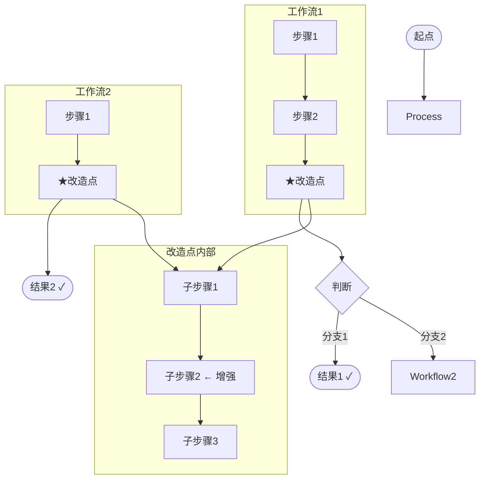
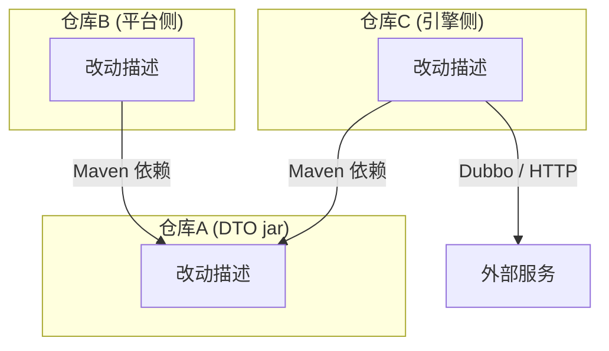

# {功能名} — 设计文档

- 日期：YYYY-MM-DD
- 最近更新：YYYY-MM-DD（简述本轮变更内容）
- 涉及模块：模块1（controller/service）、模块2（模板）、...
- 关联需求文档：`.local/_doc/{feature}/需求文档.md`
- 状态：待开发 / 已实现（分支 xxx，本地编译通过），待评审与联调验证
- 结论来源：源码文件/接口名（说明调查依据）

---

## 1. 现有机制（本次改造前）

### 1.1 数据存储分布（或现有流程概述）

| 存储/位置 | 内容 | 写入方 | 读取方 |
|---|---|---|---|
| 存储A | 内容描述 | 写入方 | 读取方 |

关键指针/关联关系说明。

### 1.2 改造入口（本次改造点）

方法签名、位置、调用链描述。

```
步骤1   说明
步骤2   说明（:行号 → 方法）
步骤3   说明
```

出现在哪些工作流模版中。

### 1.3 现有问题（可选，如已有独立问题分析则省略）

问题链路描述，含调用图。

### 1.4 操作流（如涉及多步骤流程）

```
工作流1（名称）：
1. 步骤
2. 步骤
3. ★改造点 → 状态

工作流2（名称）：
1. 步骤
2. ★改造点 → 状态
```

### 1.5 现有可复用件

| 能力 | 方法/接口 | 位置 |
|---|---|---|
| 能力描述 | 方法签名 | 文件:行号 |

## 2. 总体方案

一段话概述方案核心思路。

### 2.1 幂等性（如涉及多次执行）

幂等设计说明：先清后建、每次从源取最新值、不依赖上次执行结果。

```
改造后的流程伪代码
```

## 3. 详细设计

### 3.1 {子设计点1}

**文件**：文件路径

**现状与问题**：描述现状和不可行点。

```
现有调用链路
平台 → 服务 → 方法 → 底层调用
```

**可行方案对比**（如有多方案待决策）：

| | 方案 A | 方案 C |
|---|---|---|
| 改动 | 改动描述 | 改动描述 |
| 影响域 | 影响描述 | 影响描述 |
| 代价 | 代价描述 | 代价描述 |
| 风险 | 风险描述 | 风险描述 |

> 待决策 / 已决策说明。

### 3.2 {子设计点2} — 核心改造

**文件**：文件路径

原逻辑描述。调用方区分（方法重载等）。

- `方法签名1`——原签名不变，行为不变
- `方法签名2`——新增重载，走增强逻辑

```
方法伪代码（含注释标注原逻辑 vs 新增逻辑）
```

> 关键设计说明。

> 不调 / 不引入某能力的理由（引用源码依据）。

> 失败处理策略。

### 3.3 函数拆分（如有多个新增函数）

#### 函数一：`functionA(params)`

职责描述。

```
伪代码
```

> 设计说明。

#### 函数二：`functionB(params)`

职责描述。

```
伪代码
```

> 设计说明。

#### 函数三：`functionC(params)`

职责描述。

```
伪代码
```

> 设计说明。

### 3.4 扩展现有接口/端点（如涉及）

复用现有端点，扩展返回结构。

**新增字段说明**：

| 字段 | 含义 | 来源 |
|---|---|---|
| 字段名 | 含义 | 来源列/方法 |

```java
// 新增内部类 + 字段
```

> 不新增 API 端点、不改接口声明。现有调用方忽略新字段不影响原逻辑。

## 4. 功能触发流程



### 用法1

```
工作流:
  改造点:
    步骤描述
  → 结果 ✓
```

### 用法2

```
工作流1 ①: 同用法1（临时）
工作流2 ②:
  改造点:
    步骤描述
  → 最终结果 ✓
```

## 5. 边界特例处理（设计层面）

| 特例 | 设计处理 |
|---|---|
| 特例描述 | 处理方式（引用函数名/行号） |

## 6. 改动清单

| # | 仓库 | 文件 | 改动 |
|---|---|---|---|
| 1 | 仓库A | `文件.java` | 改动描述 |
| 2 | 仓库B | `文件.java` | 改动描述 |
| 3 | 仓库C | `文件.java` | 改动描述 |
| 4 | 仓库D | — | 无改动 |

> 约束声明：不新增 API / 不改协议 / 不新建独立 DTO / 不改 yaml / 不改表结构等。
> "本地"指开发机已检出源码；仅 Maven 制品标注"⚠️ 源码不在本地"。

### 6.1 项目依赖关系



- **仓库A**：角色说明。改动描述。
- **仓库B**：角色说明。改动描述。
- **仓库C**：角色说明。改动描述。
- **外部服务**：访问方式说明。

## 7. 待决事项（或已关闭的待决事项）

> 已解决/已关闭的待决事项：直接删除该行并顺延重编号，不保留删除线占行。

| # | 事项 | 现状/建议 |
|---|---|---|
| 1 | 待决描述 | 现状/建议 |

或已关闭：

1. **事项名**：已确认结论。依据引用。
2. **事项名**：已确认结论。依据引用。
